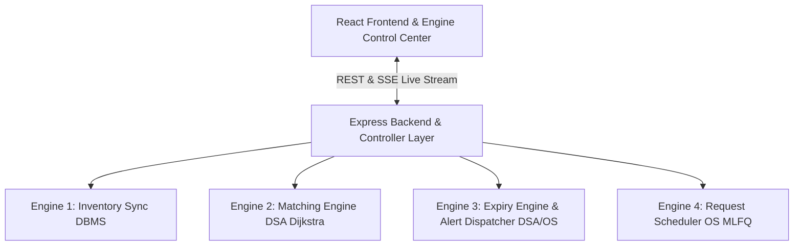

# Multi-Hospital Blood Resource Sharing System & Expiry Management

> **Engine-Centric, Priority-Driven Academic Prototype**

---

## 1. Executive Summary & Purpose

A software coordination and information system that shares blood-resource records across hospitals and manages expiry, with **priority-based scheduling** as its defining feature.

### ⚠️ Scope Boundary & Medical Disclaimer
- The application does **NOT** collect, test, or transport blood, nor make clinical compatibility or transfusion decisions.
- All matches are explicitly labeled **"Potential Match — Requires Authorized Review"**.
- Persistent Disclaimer: *"Potential match identified from recorded inventory attributes. Final authorization and clinical suitability remain with qualified personnel."*
- Persistent Banner: **"Demo data only — not for clinical or operational use."**
- Digital expiry status changes only (never physical disposal).

---

## 2. Architecture & The Four Engines

The system is built on a 3-tier architecture: **React Frontend $\rightarrow$ Express REST/SSE Backend $\rightarrow$ Database Store Engine (MySQL / Supabase / High-Performance In-Memory DB)**.



### The 4 Core Engines

1. **Inventory Sync Engine (DBMS)**:
   - Single-writer rule: strictly enforces transactions, lock ordering in ascending ID order, and movement ledger reconciliation.
   - Enforces invariant: $\text{available} = \text{quantity\_total} - \text{quantity\_held} - \text{quantity\_in\_transit}$.
2. **Matching Engine (DSA)**:
   - Calculates Dijkstra shortest paths over the hospital road graph $O((V+E) \log V)$ using a binary min-heap priority queue.
   - Computes transparent 0–100 scores (`expiryScore`, `distanceScore`, `quantityFitScore`) under `FASTEST` or `BALANCED` profiles.
3. **Expiry Engine & Alert Dispatcher (DSA + OS)**:
   - Event-driven min-heap $O(\log n)$ per transition tracking tiers: $\text{VALID} \rightarrow \text{NEAR\_EXPIRY} \rightarrow \text{CRITICAL} \rightarrow \text{EXPIRED}$.
   - Deduplicates and escalates unacknowledged critical alerts over simulated time.
4. **Request Scheduling Engine (OS)**:
   - Multilevel Priority Queue (Level 0: EMERGENCY, Level 1: URGENT, Level 2: ROUTINE).
   - Aging math prevents starvation; preemption re-enqueues lower-priority victim holds with $+15$ compensation boost.
   - Banker's Deadlock Avoidance Algorithm (`isSafeState()`) validates multi-resource requests before granting holds.

---

## 3. Technology Stack

- **Frontend**: React 18 + TypeScript + Vite + Tailwind CSS + Lucide React + Recharts + React Router DOM.
- **Backend**: Node.js + Express + Server-Sent Events (SSE) + Vitest.
- **Database Options**:
  1. Built-in High-Performance Memory Database Engine (out-of-the-box zero config execution).
  2. **Supabase PostgreSQL / MySQL Integration**: Compatible schema (`database/schema.sql`) and seed (`database/seed.sql`).

---

## 4. Quick Start & Execution

### Installation

```bash
# 1. Install dependencies for backend and frontend
cd backend && npm install
cd ../frontend && npm install
```

### Running Backend & Frontend

```bash
# Terminal 1: Backend Server (Port 5000)
cd backend
npm run dev

# Terminal 2: Frontend Web App (Port 3000)
cd frontend
npm run dev
```

Open your browser at `http://localhost:3000`.

---

## 5. Demo Login Credentials

All accounts use the password: **`demo123`**

| Role | Email | Permissions |
|---|---|---|
| **SYSTEM_ADMIN** | `admin@demo.local` | Full access, Engine Pause/Resume, Scenarios, Settings, Database Inspector |
| **REQUEST_MANAGER** | `priya@demo.local` | Issue requests, view priority queues & matches |
| **INVENTORY_MANAGER**| `anil@demo.local` | Add inventory, confirm dispatch & receipt |
| **HOSPITAL_ADMIN** | `sneha@demo.local` | Authorize request approval/rejection |

---

## 6. Running Tests & Academic Scenarios

### Backend Unit & Single-Writer Tests

```bash
cd backend
npx vitest run
```

### Academic Scenario Suite (S1 – S6)

Run Scenarios S1 through S6 directly via the UI in the **Engine Control Center $\rightarrow$ Academic Test Scenarios (S1-S6)** tab, or programmatically via `POST /api/sim/scenarios`.

| Scenario | Name | Key Verification |
|---|---|---|
| **S1** | Emergency Preemption | Preempts tentative hold, grants EMERGENCY request, applies $+15$ boost to victim |
| **S2** | Aging Math | Promotes ROUTINE request to URGENT queue after wait threshold |
| **S3** | Banker Avoidance | Executes multi-resource safety check and matrices trace |
| **S4** | Concurrency | 20 parallel hold requests tested; ledger consistency verified |
| **S5** | Expiry Fast-Forward | Advances clock $+3\text{d}, +7\text{d}$; transitions tiers & escalates alerts |
| **S6** | End-to-End Fulfillment | Request $\rightarrow$ Matched $\rightarrow$ Approved $\rightarrow$ Transferred $\rightarrow$ Received $\rightarrow$ Fulfilled |

---

## 7. Supabase Database Connection Guide

To connect to a live Supabase project:
1. Create a project at [supabase.com](https://supabase.com).
2. Go to the SQL Editor and execute `database/schema.sql` and `database/seed.sql`.
3. Set `SUPABASE_URL` and `SUPABASE_ANON_KEY` in `backend/.env`.

---

## 8. List of Assumptions

1. Simulated transit speed is set to 40 km/h with a 4-hour safety buffer for viability checks.
2. Hold TTL is set to 30 minutes in simulated clock time.
3. Preemptions apply exclusively to tentative holds (`MATCHED` status) and never to `APPROVED` or `IN_TRANSIT` requests.
