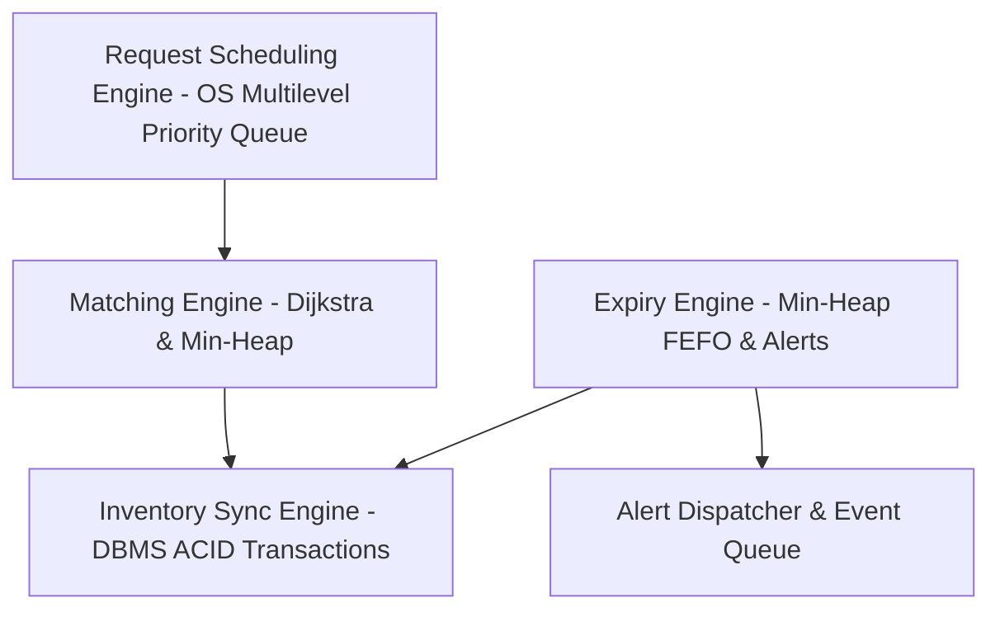

# Architecture & Engine Contracts Specification

## 1. Overview of the Four Core Engines

This system is organized around four core academic and computational engines:

---

## 2. Engine Details

### 2.1 Engine 1: Inventory Sync Engine (DBMS)
- **Subject**: Database Management Systems (DBMS)
- **Core Algorithms**: ACID Transactions, Row-locking (`SELECT ... FOR UPDATE`), Ascending-id Lock Ordering, Movement Ledger Reconciliation.
- **Single-Writer Rule**: Only this engine mutates `blood_inventory`, `inventory_holds`, and `inventory_movements`.
- **Invariants**:
  $$\text{available} = \text{quantity\_total} - \text{quantity\_held} - \text{quantity\_in\_transit}$$
  Expired units never have available quantity.
- **Source File**: [inventory_sync.engine.ts](file:///c:/Users/rutuk/OneDrive/%E6%96%87%E6%A1%A3/Desktop/mini%20project/blood_bank/backend/src/engines/inventory_sync.engine.ts)

### 2.2 Engine 2: Matching Engine (DSA)
- **Subject**: Data Structures & Algorithms (DSA)
- **Core Algorithms**: Dijkstra Shortest Path $O((V+E) \log V)$, Binary Min-Heap Priority Queue, Multi-factor Transparent Scoring.
- **Scoring Formula**:
  $$\text{Score} = w_{\text{expiry}} \cdot \text{expiryScore} + w_{\text{distance}} \cdot \text{distanceScore} + w_{\text{fit}} \cdot \text{quantityFitScore}$$
- **Profiles**:
  - `FASTEST` (Emergency): $w_{\text{expiry}}=0.25, w_{\text{distance}}=0.60, w_{\text{fit}}=0.15$
  - `BALANCED` (Routine): $w_{\text{expiry}}=0.35, w_{\text{distance}}=0.50, w_{\text{fit}}=0.15$
- **Source File**: [matching.engine.ts](file:///c:/Users/rutuk/OneDrive/%E6%96%87%E6%A1%A3/Desktop/mini%20project/blood_bank/backend/src/engines/matching.engine.ts)

### 2.3 Engine 3: Expiry Engine & Alert Dispatcher (DSA + OS)
- **Subject**: Data Structures & Operating Systems
- **Core Algorithms**: Event-Driven Min-Heap $O(\log n)$ per tier transition, Bounded Buffer Producer-Consumer Event Queue with Exponential Backoff.
- **Tiers**: $\text{VALID} \rightarrow \text{NEAR\_EXPIRY} \rightarrow \text{CRITICAL} \rightarrow \text{EXPIRED}$.
- **Source File**: [expiry.engine.ts](file:///c:/Users/rutuk/OneDrive/%E6%96%87%E6%A1%A3/Desktop/mini%20project/blood_bank/backend/src/engines/expiry.engine.ts)

### 2.4 Engine 4: Request Scheduling Engine (OS)
- **Subject**: Operating Systems (OS)
- **Core Algorithms**: Multilevel Priority Queue (Level 0: EMERGENCY base 100, Level 1: URGENT base 60, Level 2: ROUTINE base 20), Aging Starvation Prevention, Preemption with $+15$ Compensation Boost, Banker's Deadlock Avoidance Algorithm (`isSafeState()`).
- **Source File**: [request_scheduling.engine.ts](file:///c:/Users/rutuk/OneDrive/%E6%96%87%E6%A1%A3/Desktop/mini%20project/blood_bank/backend/src/engines/request_scheduling.engine.ts)

---

## 3. Computer Science Touchpoints Concept Map

| Engine / Component | Primary CS Subject | Key Concepts | File Path |
|---|---|---|---|
| Inventory Sync | DBMS | ACID, Locks, Ledger Invariants | [inventory_sync.engine.ts](file:///c:/Users/rutuk/OneDrive/%E6%96%87%E6%A1%A3/Desktop/mini%20project/blood_bank/backend/src/engines/inventory_sync.engine.ts) |
| Matching Engine | DSA | Dijkstra, Min-Heap | [matching.engine.ts](file:///c:/Users/rutuk/OneDrive/%E6%96%87%E6%A1%A3/Desktop/mini%20project/blood_bank/backend/src/engines/matching.engine.ts) |
| Expiry Engine | DSA + OS | Event-driven Heap, Priority Queue | [expiry.engine.ts](file:///c:/Users/rutuk/OneDrive/%E6%96%87%E6%A1%A3/Desktop/mini%20project/blood_bank/backend/src/engines/expiry.engine.ts) |
| Request Scheduler | OS | Multilevel Queues, Preemption, Banker's Algorithm | [request_scheduling.engine.ts](file:///c:/Users/rutuk/OneDrive/%E6%96%87%E6%A1%A3/Desktop/mini%20project/blood_bank/backend/src/engines/request_scheduling.engine.ts) |
